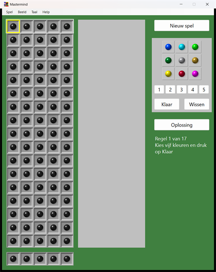
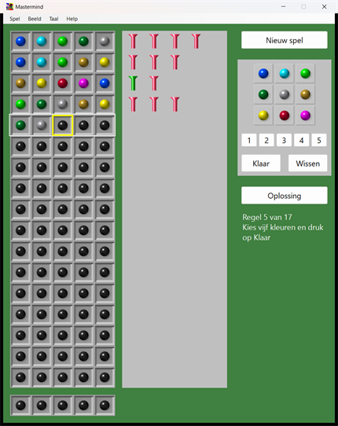
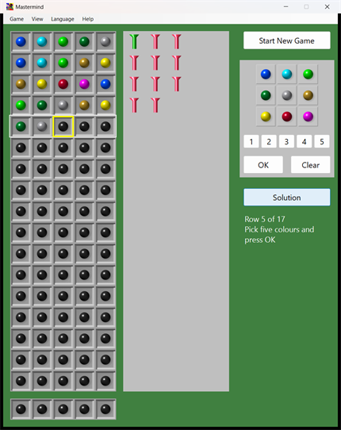

# Mastermind

[Nederlands](#nederlands) | [English](#english)

---

# Nederlands

## Handleiding

De computer verzint een geheime code van **vijf verschillende kleuren**, gekozen uit negen kleuren. Jij moet die kleuren in de goede volgorde raden. Je hebt daarvoor **zeventien regels**.

Na elke regel krijg je aanwijzingen in de vorm van groene en rode paaltjes. Daaruit kun je afleiden wat er goed is en wat niet. Geraden? Dan klinkt er een geluidje.

### Het scherm

*Het begin van een spel.*

**Links** staat het bord met zeventien regels van vijf vakjes. Een leeg vakje is een zwart balletje. De regel waar je mee bezig bent heeft een witte omlijning, het vakje dat aan de beurt is een gele.

**In het midden** komen de paaltjes te staan, naast elke regel die je hebt laten beoordelen.

**Rechts** staan de knoppen: *Nieuw spel*, het blokje met de negen kleuren, de plaatsknoppen 1 tot en met 5, *Klaar* en *Wissen*, en daaronder *Oplossing*. Daaronder staat in woorden bij welke regel je bent.

**Onderaan** het bord is een extra regel. Daar verschijnt de geheime code als je op *Oplossing* drukt, of als het spel afgelopen is.

### De negen kleuren

| Toets | 1 | 2 | 3 | 4 | 5 | 6 | 7 | 8 | 9 |
|---|:-:|:-:|:-:|:-:|:-:|:-:|:-:|:-:|:-:|
| |  |  |  |  |  |  |  |  |  |
| Kleur | blauw | cyaan | groen | donkergroen | grijs | oker | geel | donkerrood | magenta |

### Spelen

1. Klik op *Nieuw spel* (of druk op F2). De computer kiest een nieuwe code.
2. Klik een kleur in het blokje van negen. Die komt in het eerstvolgende vakje van de regel. Zo vul je de vijf vakjes van links naar rechts. Een ander vakje kies je door op de plaatsknop 1 tot en met 5 te klikken, of direct op het vakje in de regel zelf.
3. Klik op *Klaar* (of Enter). De regel wordt beoordeeld en de paaltjes verschijnen. Daarna ga je naar de volgende regel.
4. Klopt er iets niet, dan wist *Wissen* de regel waar je mee bezig bent. Dat kan zolang je nog niet op *Klaar* hebt geklikt.
5. Ga zo door tot je de code geraden hebt, of tot de zeventien regels op zijn. Daarna kan er niets meer ingevoerd worden en laat het spel de code zien.

Je mag een regel ook half ingevuld laten beoordelen. De lege vakjes geven simpelweg geen paaltje.

*Een spel in volle gang: vier regels beoordeeld, de vijfde wordt ingevuld.*

### De paaltjes

| | |
|:-:|---|
|  | **Groen**: een goede kleur op de goede plaats. |
|  | **Rood**: een goede kleur, maar op de verkeerde plaats. |

De paaltjes staan altijd op volgorde: eerst alle groene, dan alle rode. Ze zeggen dus *niet* welk balletje goed zit. Dat moet je zelf uitzoeken.

Een kleur die niet in de code zit, geeft geen paaltje. Een kleur telt hoogstens één keer mee. Vul je bijvoorbeeld vijf keer dezelfde kleur in en die zit één keer in de code, dan krijg je ook maar één paaltje.

**Voorbeeld.** De code is 1 2 3 4 5. Jij vult in 1 3 2 6 7. De 1 staat goed (**1 groen**). De 3 en de 2 zitten wel in de code maar staan op de verkeerde plaats (**2 rood**). De 6 en de 7 zitten er niet in en geven niets.

### Toetsenbord

| Toets | Wat het doet |
|---|---|
| **1** ... **9** | zet die kleur in het vakje dat aan de beurt is |
| ← → | kies een andere plaats in de regel |
| Backspace | haalt het laatste balletje weg |
| Enter | Klaar: de regel beoordelen |
| Esc | wist de regel |
| F2 | nieuw spel |
| F1 | de spelregels |
| Ctrl+C | kopieert de gespeelde regels als tekst naar het klembord |

### Het menu

| Menu | Inhoud |
|---|---|
| **Spel** | Nieuw spel (F2), Oplossing tonen, Regels kopiëren (Ctrl+C), Afsluiten |
| **Beeld** | *Grootte*: automatisch, 1, 2 of 3 keer zo groot (handig op een 4K-scherm). *Geluid*: het geluidje bij winst aan of uit. *Tekening*: gerekend, met de hand getekend, of zoals in 1995. |
| **Taal** | Nederlands of English. De keuze wordt onthouden. |
| **Help** | Spelregels (F1) en Over Mastermind. |

Taal, grootte, tekening en geluid worden onthouden tot de volgende keer (in `%APPDATA%\Mastermind\instellingen.txt`). Het programma begint standaard in het Engels, zoals het origineel uit 1995. Met een snelkoppeling naar `Mastermind.exe /nl` start het meteen in het Nederlands, met `/en` in het Engels.

### Tips

Omdat de code uit vijf *verschillende* kleuren bestaat (er zijn 15.120 mogelijke codes), is dit makkelijker dan de gewone Mastermind-regels. Een computer die slim gokt en na elke regel alle codes schrapt die niet meer kunnen, haalt het gemiddeld in 5,8 regels en nooit meer dan 8. Zeventien regels is dus ruim voldoende.

Begin met vijf verschillende kleuren, bijvoorbeeld 1 2 3 4 5. Het aantal paaltjes vertelt je hoeveel van die kleuren in de code zitten. Verwissel daarna steeds een paar kleuren of vervang er een door een kleur die je nog niet geprobeerd hebt, en kijk wat er verandert. Schrijf op wat je hebt geleerd, bijvoorbeeld welke kleuren er zeker niet in zitten.

### Over dit programma

Het oorspronkelijke programma is in 1995 geschreven door Ed Nieuwenhuys en Ronald Loggen in Borland C++ voor Windows 3.1. Deze versie is opnieuw gebouwd in C# voor Windows 10 en 11 en draait als één exe-bestand, zonder dat je .NET hoeft te installeren. De balletjes en paaltjes komen uit het origineel.

Het tellen van de paaltjes is op één punt verbeterd: in 1995 leverde een herhaalde kleur in een gok te veel rode paaltjes op. Dat is nu zoals in de gewone Mastermind-regels. Wie vijf verschillende kleuren invult, krijgt precies dezelfde paaltjes als toen.

De volledige verantwoording van de omzetting staat in [LEESMIJ-CSharp.md](LEESMIJ-CSharp.md).

---

# English

## Manual

The computer makes up a secret code of **five different colours**, picked from nine colours. You have to guess those colours in the right order. You get **seventeen rows** to do it.

After each row you get hints in the form of green and red pegs. From these you can work out what is right and what is not. Cracked it? Then a little sound is played.

### The screen

*The start of a game.*

On the **left** is the board with seventeen rows of five squares. An empty square is a black ball. The row you are working on has a white outline, the square that is next in line a yellow one.

In the **middle** the pegs appear, beside every row you have had judged.

On the **right** are the buttons: *Start New Game*, the block of nine colours, the position buttons 1 to 5, *OK* and *Clear*, and below that *Solution*. Below those, in words, is the row you are on.

At the **bottom** of the board is an extra row. The secret code appears there when you press *Solution*, or when the game is over.

### The nine colours

| Key | 1 | 2 | 3 | 4 | 5 | 6 | 7 | 8 | 9 |
|---|:-:|:-:|:-:|:-:|:-:|:-:|:-:|:-:|:-:|
| |  |  |  |  |  |  |  |  |  |
| Colour | blue | cyan | green | dark green | grey | ochre | yellow | dark red | magenta |

### Playing

1. Click *Start New Game* (or press F2). The computer picks a new code.
2. Click a colour in the block of nine. It goes in the next square of the row. This way you fill the five squares from left to right. To choose a different square, click the position button 1 to 5, or click the square in the row itself.
3. Click *OK* (or Enter). The row is judged and the pegs appear. Then you move on to the next row.
4. If something is wrong, *Clear* wipes the row you are working on. This works as long as you have not yet clicked *OK*.
5. Carry on until you have cracked the code, or until the seventeen rows are used up. After that nothing more can be entered and the game shows you the code.

You may also have a half-filled row judged. The empty squares simply give no peg.

*A game in progress: four rows judged, the fifth is being filled in.*

### The pegs

| | |
|:-:|---|
|  | **Green**: a right colour in the right place. |
|  | **Red**: a right colour, but in the wrong place. |

The pegs are always in order: all the green ones first, then all the red ones. So they do *not* tell you which ball is right. You have to work that out yourself.

A colour that is not in the code gives no peg. A colour counts at most once. If you fill in the same colour five times and it is in the code once, you also get just one peg.

**Example.** The code is 1 2 3 4 5. You enter 1 3 2 6 7. The 1 is in the right place (**1 green**). The 3 and the 2 are in the code but in the wrong place (**2 red**). The 6 and the 7 are not in the code and give nothing.

### Keyboard

| Key | What it does |
|---|---|
| **1** ... **9** | puts that colour in the current square |
| ← → | choose another position in the row |
| Backspace | removes the last ball |
| Enter | OK: judge the row |
| Esc | clears the row |
| F2 | start a new game |
| F1 | the rules of the game |
| Ctrl+C | copies the rows played to the clipboard as text |

### The menu

| Menu | Contents |
|---|---|
| **Game** | New game (F2), Show solution, Copy rows (Ctrl+C), Exit |
| **View** | *Size*: automatic, 1, 2 or 3 times as large (handy on a 4K screen). *Sound*: the sound on a win on or off. *Artwork*: computed, hand-drawn, or as in 1995. |
| **Language** | Nederlands or English. The choice is remembered. |
| **Help** | How to play (F1) and About Mastermind. |

Language, size, artwork and sound are remembered until the next time (in `%APPDATA%\Mastermind\instellingen.txt`). The program starts in English by default, like the 1995 original. With a shortcut to `Mastermind.exe /nl` it starts in Dutch right away, with `/en` in English.

### Tips

Because the code consists of five *different* colours (there are 15,120 possible codes), this is easier than the usual Mastermind rules. A computer that guesses cleverly and, after every row, crosses off all the codes that are no longer possible needs 5.8 rows on average and never more than 8. Seventeen rows is therefore plenty.

Start with five different colours, for example 1 2 3 4 5. The number of pegs tells you how many of those colours are in the code. Then keep swapping a pair of colours, or replace one by a colour you have not tried yet, and see what changes. Write down what you have learned, for instance which colours are certainly not in the code.

### About this program

The original program was written in 1995 by Ed Nieuwenhuys and Ronald Loggen in Borland C++ for Windows 3.1. This version has been rebuilt in C# for Windows 10 and 11 and runs as a single exe file, without having to install .NET. The balls and pegs come from the original.

The counting of the pegs has been improved in one place: in 1995 a repeated colour in a guess gave too many red pegs. It now works as in the usual Mastermind rules. If you enter five different colours you get exactly the same pegs as back then.

The full account of the conversion (in Dutch) is in [LEESMIJ-CSharp.md](LEESMIJ-CSharp.md).
